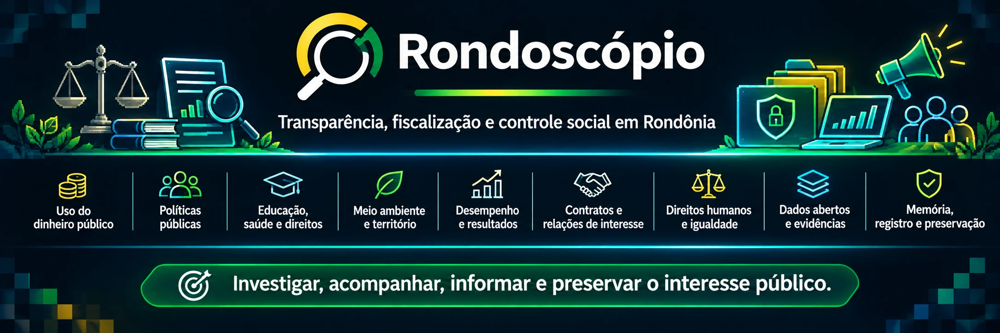

# Rondoscópio

**Fiscalização do poder público, memória documental e educação cívica em Rondônia.**

O Rondoscópio é uma iniciativa independente em formação, dedicada à investigação documental, ao controle social, à transparência e à educação cívica e histórica. Seu foco inicial é o estado de Rondônia e seus municípios.

Queremos tornar mais compreensíveis as decisões que afetam a sociedade, acompanhar a aplicação de recursos públicos, preservar documentos e examinar os resultados de políticas públicas. Isso inclui investigar possíveis omissões, favorecimentos e conflitos de interesses, sempre distinguindo fatos documentados, hipóteses e conclusões.

## O que pretendemos acompanhar

Entre as áreas previstas estão a atuação dos poderes Executivo, Legislativo e Judiciário, os órgãos de controle, as empresas públicas e outras entidades que administram recursos públicos ou prestam serviços de interesse coletivo.

A investigação poderá abordar orçamento, licitações, contratos, emendas, transferências, obras e beneficiários de decisões públicas. Também pretendemos acompanhar saúde, educação, segurança, direitos humanos, violência, desigualdades, meio ambiente, desenvolvimento regional e acesso a serviços essenciais, incluindo situações em que a ausência de políticas públicas produza consequências documentáveis.

A memória histórica e a educação cívica integram essa finalidade: entender como as instituições funcionam, como decisões foram tomadas e o que mudou ao longo do tempo.

O detalhamento está nas minutas de [áreas de atuação e objetivos de fiscalização](https://github.com/Rondoscopio/constituicao/blob/main/parts/01-identidade/008-areas-de-atuacao-e-objetivos-de-fiscalizacao.md) e no [catálogo de metas, indicadores e referenciais](https://github.com/Rondoscopio/constituicao/blob/main/parts/05-metodologia/022-catalogo-de-metas-e-indicadores.md).

## Princípios

A atuação proposta se orienta pela independência em relação a governos, partidos, candidatos, grupos econômicos e financiadores, pela dignidade humana, pela proteção de fontes e pela investigação baseada em evidências verificáveis.

Não se trata de fiscalizar apenas um grupo político. Atos, decisões e omissões devem poder ser examinados independentemente de quem os pratique. O trabalho deverá preservar as fontes, explicar métodos, confrontar versões, consultar pesquisas e experiências comparáveis, reconhecer incertezas e assegurar contraditório, direito de resposta e correção documentada de erros.

Uma relação pessoal, coincidência ou anomalia pode justificar investigação, mas não constitui, isoladamente, prova de irregularidade. Interesse público não elimina a privacidade nem autoriza divulgação indiscriminada de dados pessoais.

Nossos fundamentos, garantias e procedimentos estão documentados na [Constituição do Rondoscópio](https://github.com/Rondoscopio/constituicao). **Os textos institucionais ainda são minutas**, não normas aprovadas nem prova da existência de órgãos internos já instalados.

## Projetos

### [Constituição](https://github.com/Rondoscopio/constituicao)

Reúne a Carta Fundadora, os princípios, objetivos, métodos de investigação, propostas de governança, garantias institucionais, direitos, políticas e referenciais. É a base documental dos demais projetos.

### [OSINT Rondônia](https://github.com/Rondoscopio/osint-rondonia)

Catálogo público de fontes de dados, ferramentas e referências para pesquisa, jornalismo e fiscalização cidadã, com foco em Rondônia e acesso também a fontes brasileiras e internacionais.

### [Amnésia](https://github.com/Rondoscopio/amnesia)

Sistema planejado de coleta e monitoramento multimodal de fontes públicas, incluindo textos, documentos, áudios, vídeos e dados estruturados. Pretende catalogar e preservar registros com informações sobre proveniência, histórico, integridade e condições de acesso.

### [Córtex](https://github.com/Rondoscopio/cortex)

Motor de inteligência e análise de dados em planejamento. Pretende cruzar registros e evidências, investigar relações, identificar padrões e possíveis irregularidades, avaliar políticas públicas e produzir indicadores e relatórios verificáveis. Indícios não serão apresentados como provas conclusivas.

### [Ouvidoria](https://github.com/Rondoscopio/ouvidoria)

Projeto de canal para receber, registrar, acompanhar e encaminhar manifestações, como denúncias, reclamações, sugestões e pedidos de correção, com atenção à proteção de denunciantes e de dados sensíveis. **O serviço ainda não está disponível.**

### [Portal](https://github.com/Rondoscopio/portal)

Será a interface pública para apresentar informações, investigações, indicadores, séries históricas, documentos, análises e materiais de educação cívica, com fontes e limitações identificáveis.

### [Preservador](https://github.com/Rondoscopio/preservador)

Desenvolverá softwares para que colaboradores credenciados mantenham cópias independentes e verificáveis de conjuntos de dados autorizados, reduzindo o risco de perda do acervo diante de falhas, desastres, ataques e tentativas de apagamento. A rede de preservação ainda não está em operação.

## Como participar

São bem-vindas contribuições em pesquisa de fontes, revisão documental, desenvolvimento de software, segurança, testes, acessibilidade, metodologia e correção de informações. Consulte as orientações de cada repositório e os [documentos comunitários](https://github.com/Rondoscopio/.github).

Issues, pull requests e discussões públicas servem para questões técnicas e propostas que possam ser compartilhadas abertamente. **Não envie denúncias sensíveis, informações sigilosas, dados pessoais desnecessários ou credenciais pelo GitHub.** O Rondoscópio ainda não dispõe de canal operacional para receber esses relatos com garantias de proteção.

## Situação atual e limites

O Rondoscópio está em formação. Os repositórios apresentam fundamentos, objetivos e softwares planejados; a existência de um repositório não significa que seu serviço esteja disponível.

A iniciativa não exerce poder policial, judicial ou de tribunal de contas, não declara culpabilidade criminal e não substitui autoridades competentes, assistência jurídica ou serviços de emergência. Sua contribuição pretendida é documentar, analisar, explicar, preservar e dar publicidade responsável a informações de interesse coletivo.
